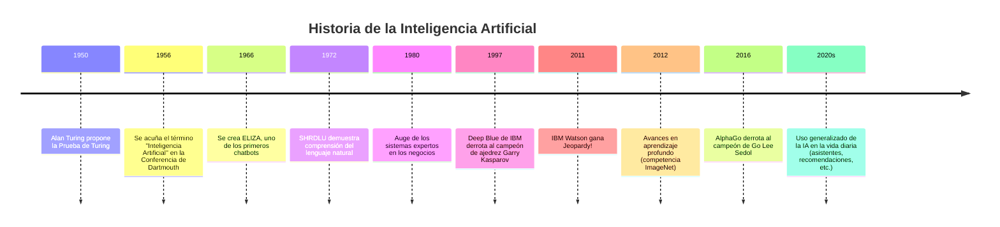

---
tiempoDeLectura:
  minutos: 2.856
  palabras: 714
fkglResultado: 9.3
---

# `01.0` - ¿Qué es la Inteligencia Artificial?

¡Bienvenido de nuevo, explorador de IA! Después de haber echado un vistazo a lo que este curso tiene preparado en nuestra lección introductoria, es momento de adentrarnos en el corazón del asunto. Comencemos con la pregunta fundamental: *¿Qué es exactamente la Inteligencia Artificial (IA)?* En esta lección, desglosaremos la definición de IA, repasaremos su historia, exploraremos sus principios básicos y veremos cómo imita la inteligencia humana a través de ejemplos simples y cercanos.

## 🤖 Definiendo la Inteligencia Artificial

En esencia, la **Inteligencia Artificial (IA)** se refiere al desarrollo de sistemas informáticos capaces de realizar tareas que normalmente requieren inteligencia humana. Estas tareas incluyen aprender de la experiencia, resolver problemas, comprender el lenguaje, reconocer patrones y tomar decisiones. Piensa en la IA como una forma de enseñar a las máquinas a "pensar" y "actuar" como humanos en contextos específicos.

La IA no se trata solo de robots o películas de ciencia ficción: es un campo amplio que impulsa muchas herramientas que usamos a diario. Pero, ¿cómo comenzó todo? Echemos un vistazo rápido a sus orígenes.

## 📜 Breve historia de la IA

El concepto de IA se remonta a la década de 1950, cuando el científico informático Alan Turing propuso la idea de que las máquinas pudieran simular el pensamiento humano. En 1956, el término "Inteligencia Artificial" fue acuñado en una conferencia en Dartmouth College. Los primeros sistemas de IA eran simples, como programas que jugaban a las damas, pero sentaron las bases para las tecnologías avanzadas de hoy.

A lo largo de las décadas, la IA evolucionó con avances en la potencia de cómputo, el almacenamiento de datos y los algoritmos. Desde los años 90, cuando Deep Blue de IBM derrotó al campeón de ajedrez Garry Kasparov, hasta la IA moderna como los asistentes virtuales, el recorrido de la IA refleja la búsqueda humana por replicar la inteligencia.



## 🧠 Principios básicos de la IA

La IA se basa en algunas ideas clave que ayudan a las máquinas a imitar la inteligencia humana:
- **Aprendizaje**: Los sistemas de IA pueden mejorar con el tiempo analizando datos. Por ejemplo, una aplicación de música aprende tus preferencias y sugiere canciones que podrían gustarte.
- **Razonamiento**: La IA puede resolver problemas sacando conclusiones lógicas. Piensa en una app de navegación que encuentra la ruta más rápida según el tráfico.
- **Percepción**: La IA puede interpretar el mundo a través de sentidos como la visión o el sonido. El reconocimiento facial en tu teléfono es un gran ejemplo.
- **Interacción**: La IA puede comunicarse con humanos, como se ve en los chatbots o asistentes de voz como Siri o Alexa.

Estos principios permiten que la IA aborde tareas complejas, a menudo más rápido y con mayor precisión que los humanos en áreas específicas.

## 🌍 Por qué la IA es importante hoy

La IA ya no es un sueño lejano: es una parte significativa de nuestro mundo. Desde recomendar películas en plataformas de streaming hasta ayudar a los médicos a diagnosticar enfermedades, la IA está transformando la forma en que vivimos y trabajamos. Su capacidad para procesar grandes cantidades de datos y encontrar patrones la hace invaluable para resolver problemas reales.

Considera este ejemplo sencillo: cuando escribes una búsqueda en Google, la IA predice lo que buscas y ofrece sugerencias antes de que termines de escribir. Esta pequeña comodidad ahorra tiempo y muestra cómo la IA mejora las experiencias cotidianas.

### 🏆 Mini reto

¿Puedes detectar la IA en tu rutina diaria? Anota dos ejemplos de herramientas o funciones de IA con las que interactúas regularmente.

```question eval="El estudiante debe listar dos ejemplos de IA en su vida diaria, como asistentes virtuales, sistemas de recomendación o dispositivos inteligentes. Cualquier ejemplo relevante es aceptable."

Ejemplo 1: 
```

## 🌟 Para terminar

¡Excelente trabajo al sumergirte por primera vez en la IA! Has aprendido qué es la Inteligencia Artificial, has visto un poco de su historia, comprendido sus principios básicos y su importancia en el mundo actual. A medida que avancemos, exploraremos cómo se usa la IA en diferentes contextos e industrias. Mantén presente esta base: te ayudará a conectar ideas a medida que progresamos.

Antes de continuar, reflexiona sobre esto: ¿Cómo crees que la IA podría cambiar la forma en que vivimos en los próximos 10 años? Guarda ese pensamiento mientras avanzamos a la siguiente lección, *Usos de la IA*. ¡Haz clic para continuar y sigamos explorando!
