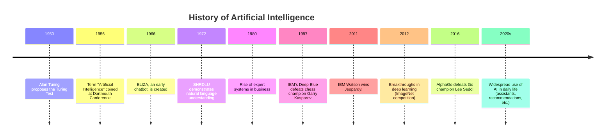

---
readingTime:
  minutes: 2.856
  words: 714
fkglResult: 9.3
---

# `01.0` - What is Artificial Intelligence

Welcome back, AI explorer! After getting a glimpse of what this course has in store in our introductory lesson, it's time to dive into the heart of the matter. Let's start with the fundamental question: *What exactly is Artificial Intelligence (AI)?* In this lesson, we'll unpack the definition of AI, touch on its history, explore its core principles, and see how it mimics human intelligence through simple, relatable examples.

## 🤖 Defining Artificial Intelligence

At its core, **Artificial Intelligence (AI)** refers to the development of computer systems that can perform tasks that typically require human intelligence. These tasks include learning from experience, solving problems, understanding language, recognizing patterns, and making decisions. Think of AI as a way to teach machines to "think" and "act" like humans in specific contexts.

AI isn't just about robots or sci-fi movies—it's a broad field that powers many tools we use daily. But how did it all begin? Let's take a quick look at its origins.

## 📜 A Brief History of AI

The concept of AI dates back to the 1950s when computer scientist Alan Turing proposed the idea of machines that could simulate human thinking. In 1956, the term "Artificial Intelligence" was coined at a conference at Dartmouth College. Early AI systems were simple, like programs that played checkers, but they laid the groundwork for today's advanced technologies.

Over the decades, AI evolved with breakthroughs in computing power, data storage, and algorithms. From the 1990s, when IBM's Deep Blue defeated chess champion Garry Kasparov, to modern AI like virtual assistants, the journey of AI reflects humanity's quest to replicate intelligence. 




## 🧠 Core Principles of AI

AI is built on a few key ideas that help machines mimic human intelligence:
- **Learning**: AI systems can improve over time by analyzing data. For example, a music app learns your preferences and suggests songs you might like.
- **Reasoning**: AI can solve problems by drawing logical conclusions. Think of a navigation app finding the fastest route based on traffic data.
- **Perception**: AI can interpret the world through senses like vision or sound. Facial recognition on your phone is a great example.
- **Interaction**: AI can communicate with humans, as seen with chatbots or voice assistants like Siri or Alexa.

These principles allow AI to tackle complex tasks, often faster and more accurately than humans in specific areas.

## 🌍 Why AI Matters Today

AI is no longer a distant dream—it's a significant part of our world. From recommending movies on streaming platforms to helping doctors diagnose diseases, AI is transforming how we live and work. Its ability to process vast amounts of data and find patterns makes it invaluable in solving real-world problems.

Consider this simple example: when you type a search into Google, AI predicts what you're looking for and offers suggestions before you finish typing. This small convenience saves time and shows how AI enhances everyday experiences.


### 🏆 Mini Challenge

Can you spot AI in your daily routine? Jot down two examples of AI tools or features you interact with regularly.

```question eval="The student should list two examples of AI in their daily life, such as virtual assistants, recommendation systems, or smart devices. Any relevant examples are acceptable."

Example 1: 
```

## 🌟 Wrapping Up

Great job taking your first deep dive into AI! You've learned what Artificial Intelligence is, glimpsed its history, understood its core principles, and seen its significance in today's world. As we move forward, we'll explore how AI is used in various contexts and industries. Keep this foundation in mind—it will help you connect the dots as we progress.

Before we continue, reflect on this: How do you think AI might change the way we live in the next 10 years? Hold that thought as we head into the next lesson, *Usages of AI*. Click to continue and let's keep exploring!
