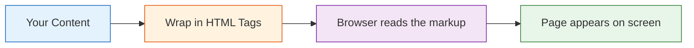

# 01.0 What is HTML?

Think of a blueprint for a house. It doesn't build the house -- it describes where walls, doors, and windows go. In the same way, **HTML** describes the structure of a web page. HTML stands for **HyperText Markup Language**, and the key word is *markup*.

## What Does "Markup Language" Mean?

Markup means adding labels to content so the browser knows what it is. Imagine labeling boxes in a warehouse: you stick a "Fragile" label on a glass box, or a "Books" label on a carton. HTML does the same thing with text -- it wraps content in **tags** like `<h1>` to say "this is a heading" or `<p>` to say "this is a paragraph."

A **programming language**, like JavaScript or Python, gives the computer step-by-step instructions to follow -- things like "if this happens, do that" or "repeat this five times." HTML has none of that. There are no `if` statements, no loops, no variables. Only labels. That is what makes it a markup language, not a programming language.

## HTML Is the Skeleton

If a web page were a person, HTML would be the skeleton: it provides the structure. The **style** (colors, fonts, layout) comes from CSS, and the **behavior** (animations, interactivity) comes from JavaScript. For now, you only need to focus on structure -- and structure is just content wrapped in the right tags.

Let's see how the process works from content to rendered page.



Now check your understanding with a quick fill-in.

```fill_in_the_blank 1="markup" 2="programming" 3="HyperText,Hypertext" 4="Markup" 5="Language" 6="label,describe,mark up,structure"
HTML is a _1_ language, not a _2_ language. HTML stands for _3_ _4_ _5_ Language, and it uses tags to _6_ content so the browser knows how to display it.
```