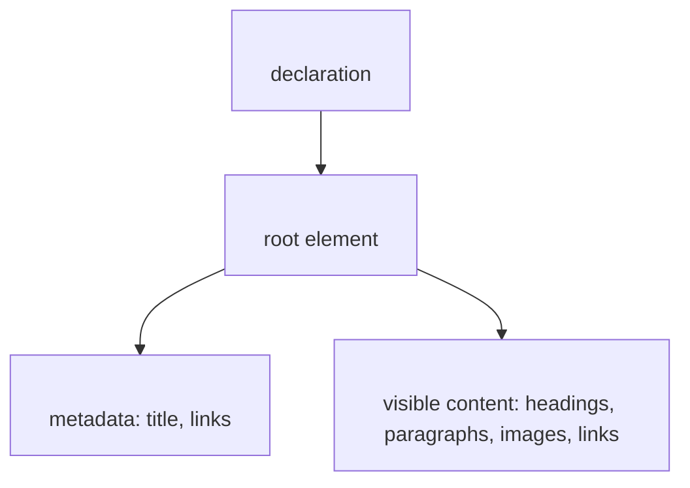

# 01.1 The HTML Document Structure

You already know that HTML wraps content in tags. But where do those tags go? Every HTML page follows the same four-part skeleton. Think back to the house blueprint: there's a title block that says what the project is, and a floor plan that shows the rooms. HTML has the same split.

## The Four Parts of Every HTML Page

Every valid HTML document has these four pieces, in this order:

- `<!DOCTYPE html>` — This is not an HTML tag. It's a declaration that tells the browser, "This is an HTML5 document." It must be the very first thing.
- `<html>` — This is the root element. Everything else lives inside it.
- `<head>` — This holds **metadata**: information *about* the page, like its title. Nothing in `<head>` shows up on the page itself.
- `<body>` — This holds everything the user **sees**: headings, paragraphs, images, links.

Here's what that looks like in code:

```html
<!DOCTYPE html>
<html>
  <head>
    <title>My First Page</title>
  </head>
  <body>
    <h1>Welcome!</h1>
    <p>This is visible content.</p>
  </body>
</html>
```

Notice how `<head>` and `<body>` are both inside `<html>`, and the doctype sits outside. This nesting is not optional — it's the rule.



Now check your understanding: which part of the document holds the visible content?

1. Which part of an HTML document contains everything the user sees on the page?

    - [ ] <!DOCTYPE html>
    - [x] <body>
    - [ ] <html>
    - [ ] <head>