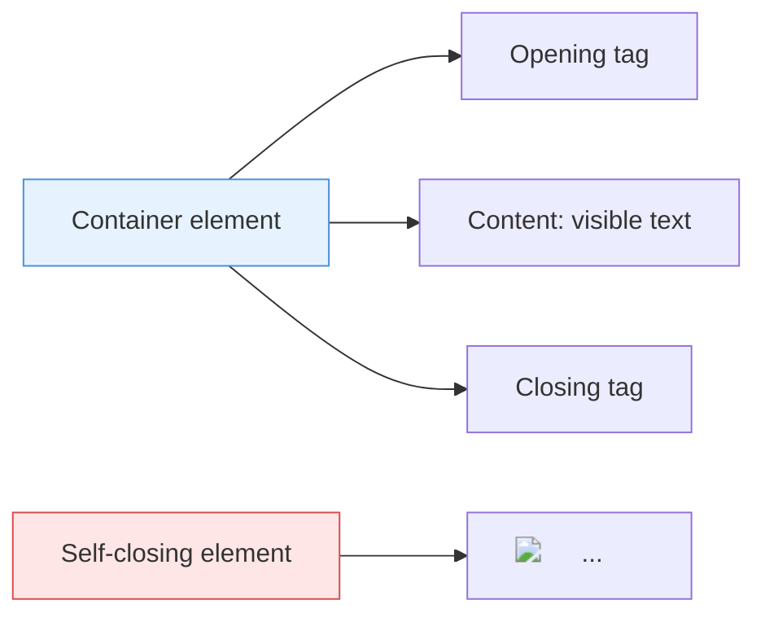

# 02.0 HTML Elements: Opening and Closing Tags

You now know the HTML skeleton: `<!DOCTYPE html>`, `<html>`, `<head>`, and `<body>`. But what fills that skeleton? **Elements** — the bricks that build the page. Every heading, paragraph, image, or link is an element. And every element follows one of two patterns.

## The Container Pattern: Open, Add Content, Close

Most HTML elements work like a labeled box: you *open* the box, drop content inside, then *close* the box. The opening tag looks like `<tagname>`, and the closing tag adds a forward slash before the name: `</tagname>`. Whatever you put between them is the element's content.

```html
<p>This is a paragraph of text.</p>
```

Here `<p>` is the opening tag, `This is a paragraph of text.` is the content, and `</p>` is the closing tag. Miss the closing tag, and the browser doesn't know where the paragraph ends — content 'leaks' into the rest of the page.

## The Self-Closing Pattern: No Content, No Closing Tag

Some elements don't hold content — they insert something onto the page. These are called **void** or **self-closing** elements. The most common one is ``. It has no closing tag because it doesn't wrap anything; it just places an image.

```html

```

Notice there's no `</img>`. The attributes (`src` and `alt`) are the settings that tell the browser what image to show. Don't try to put content between `` and a closing tag — self-closing elements can't hold content.

Both patterns side by side:



One last detail: the closing tag always matches the opening tag name. Opening with `<h2>` means closing with `</h2>`, not `</h1>`. Keep that forward slash in the right place, and your elements will snap into shape.

```fill_in_the_blank 1="closing tag" 2=",img,"
A container element like a paragraph is written with an opening tag, content, and a _1_ like </p>. A self-closing element like _2_ has no closing tag and no content.
```