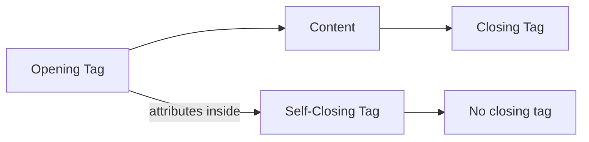

# 02.1 HTML Attributes: Adding Settings to Elements

In the last lesson, you learned that HTML elements follow two patterns: container elements (like `<p>`) with an opening tag, content, and a closing tag — and self-closing elements (like ``) that insert something onto the page with no closing tag. But a self-closing `` with no attributes is like a TV that's plugged in but has no channel — it exists, but it has nothing to show. **Attributes** are the knobs and dials that make your elements do useful things.

## Attributes Live Inside the Opening Tag

An attribute is a **key=value** pair written inside the opening tag. The key tells the browser *what setting to change*, and the value tells it *what to set it to*. Different attributes are separated by a space, and the value must be wrapped in double quotes.



Here's what that looks like in practice. A bare `` tag does nothing — it's just a broken image icon:

```html

```

But add a `src` attribute (the 'source' setting) and an `alt` attribute (the 'alternate text' setting), and suddenly it works:

```html

```

The same idea applies to links. An `<a>` tag without an `href` is like a remote control with no button — it doesn't go anywhere:

```html
<a>Click me</a>
```

Add the `href` attribute (the 'hypertext reference' setting), and the link becomes functional:

```html
<a href="https://example.com">Click me</a>
```

## Two Rules to Keep Straight

First, attributes **never** go after the closing tag. Only the opening tag can hold attributes — the closing tag is just `</tagname>` with nothing extra.

Second, the quotes around the value are required. Writing `src=photo.jpg` (without quotes) might work by accident in some browsers, but it's incorrect and will break if the value contains spaces or special characters. Always use double quotes: `src="photo.jpg"`.

Not every tag needs attributes. A `<p>` paragraph works perfectly fine with just plain text inside. Attributes are only needed when you want to **configure** the element — telling it what image to show, where to link, or how to behave.

Now it's your turn. Open `index.html` and write an `` tag that displays a placeholder image and includes the required `alt` attribute.

```code_challenge_proposal
In this exercise, the student needs to write an  tag in index.html that displays a placeholder image from https://picsum.photos/200/300. The tag must include an alt attribute with the text 'A random placeholder photo'. The student should open index.html and write the complete img element with both attributes.
```

If you get stuck on the syntax, Rigo can help:

[Ask Rigo about HTML attributes](https://4geeks.com/ask?query=can-you-explain-in-simple-terms-what-attributes-are-in-html-and-how-to-use-them-with-examples)