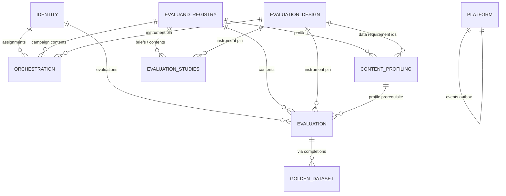
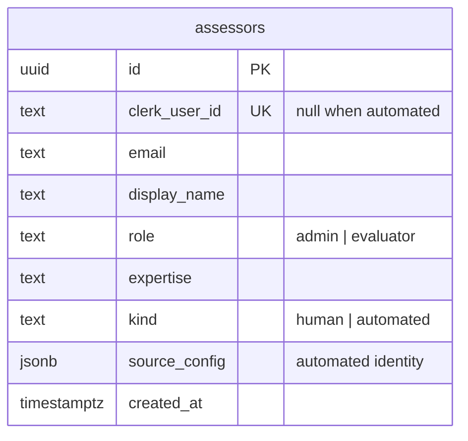
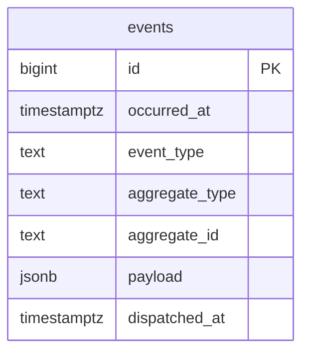
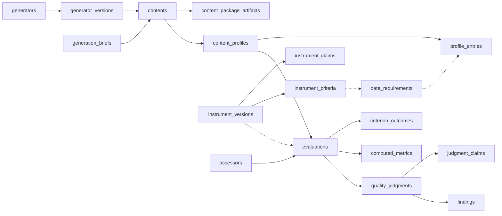

# DATA_MODEL — logical Postgres schema

Logical model of the tables the system persists today. Source of truth for shape:
Alembic migrations under `backend/alembic/versions/` (head = `0017`). Names follow
`GLOSSARY.md`. Module boundaries follow `ARCHITECTURE.md`: intra-module foreign keys
are real; many cross-module identifiers are **app-validated references** (no DB FK),
shown below as dashed links.

Retired and absent from this model: `metadata_schemas`, `contents.metadata`,
`campaigns.metadata_view` (ADR-0017).

## 1. Module map



| Module | Tables |
|---|---|
| identity | `assessors` |
| evaluand_registry | `contents`, `content_package_artifacts`, `generators`, `generator_versions`, `generation_briefs` |
| evaluation_design | `pedagogical_frameworks`, `pedagogical_dimensions`, `qualities`, `data_requirements`, `instrument_versions`, `instrument_claims`, `instrument_criteria`, `instrument_bindings`, `rubric_versions`, `criteria` |
| content_profiling | `content_profiles`, `profile_entries`, `profile_extras`, `extraction_acceptances` |
| evaluation | `evaluations`, `criterion_scores`, `criterion_outcomes`, `computed_metrics`, `quality_judgments`, `judgment_claims`, `findings`, `assessor_ratifications` |
| orchestration | `campaigns`, `campaign_contents`, `assignments`, `content_evaluation_completions` |
| golden_dataset | `golden_references` |
| evaluation_studies | `studies`, `study_recipe`, `study_dataset`, `study_reports` |
| platform | `events` |

Reporting owns no tables: it aggregates through query ports (ADR-0006).

## 2. identity



- Human: `clerk_user_id` required, `source_config` null.
- Automated: `source_config` required (`name`, `version`, target instrument, …),
  `clerk_user_id` null; partial unique on `(source_config->>'name', source_config->>'version')`.

## 3. evaluand_registry

```mermaid
erDiagram
    generation_briefs ||--o{ contents : "brief_id"
    generators ||--o{ generator_versions : "generator_id"
    generator_versions ||--o{ contents : "generator_version_id"
    contents ||--o{ content_package_artifacts : "package surface"

    generation_briefs {
        uuid id PK
        text brief
        jsonb fields
        text brief_hash UK "nullable; mechanical intake"
        timestamptz created_at
    }

    generators {
        uuid id PK
        text name "unique on lower(btrim(name)); the lineage"
        timestamptz created_at
    }

    generator_versions {
        uuid id PK
        uuid generator_id FK
        text version
        jsonb metadata "reference data the version declares about itself; write-once"
        timestamptz created_at
    }

    contents {
        uuid id PK
        text package_format
        text external_id
        text version
        text content_hash "nullable"
        text consumable_url "nullable; deployment"
        uuid brief_id FK "nullable = absent"
        uuid generator_version_id FK "nullable = unknown"
        text edit_provenance "pure | human_edited | unknown"
        uuid generator_attributed_by "late attribution"
        timestamptz generator_attributed_at
        timestamptz created_at
    }

    content_package_artifacts {
        uuid content_id PK_FK
        int ord PK
        text kind
        text locator
        text format
    }
```

Logical content identity: `(package_format, external_id, version)` unique.
Generator identity in two grains (ADR-0031): a lineage is unique on `lower(btrim(name))` — an
expression index, so casing and padding cannot make two — and a version is unique on
`(generator_id, version)`. `content_hash` supports discovery dedupe; `consumable_url` declares a
deployment, not package bytes.

## 4. evaluation_design

Norm-side reference data and the Instrument aggregate. `rubric_versions` / `criteria` store
**Rubric v1** (human reference panel); new instruments live in `instrument_*`.

```mermaid
erDiagram
    pedagogical_dimensions ||--o{ qualities : "dimension_id"
    instrument_versions ||--o{ instrument_claims : "owns"
    instrument_versions ||--o{ instrument_criteria : "owns"
    instrument_versions ||--o{ instrument_bindings : "owns"
    rubric_versions ||--o{ criteria : "owns"

    pedagogical_frameworks {
        text id PK
        text citation
        text name
        text scope_note
    }

    pedagogical_dimensions {
        text id PK
        text name
    }

    qualities {
        text id PK
        text name
        text definition
        text dimension_id FK
        jsonb grounded_in
    }

    data_requirements {
        text id PK
        text definition
        jsonb aliases
        jsonb value_domain "mandatory"
        jsonb grounded_in
        timestamptz created_at
    }

    instrument_versions {
        text id PK
        text instrument_id
        text version
        text name
        text purpose
        text status "draft | published | deprecated"
        jsonb quality_dimensions "frozen quality→dimension"
        timestamptz published_at
        uuid published_by
        uuid revision_author
        text revision_reason
        jsonb assisted_by
    }

    instrument_claims {
        text instrument_version_id PK_FK
        text claim_id PK
        int ord
        text statement
        jsonb quality_ids
        jsonb warrants
        jsonb alternative_explanations
        jsonb sufficiency
    }

    instrument_criteria {
        text instrument_version_id PK_FK
        text criterion_id PK
        int ord
        text statement
        text pass_condition
        jsonb failure_modes
        jsonb claim_ids
        jsonb required_data
        text on_missing_evidence "no_evidence | fail"
        jsonb eligible_sources
        jsonb condition
    }

    instrument_bindings {
        text instrument_version_id PK_FK
        text package_format PK
        jsonb task_variables
    }

    rubric_versions {
        text id PK
        text rubric_id
        text version
        text name
        text status
        text scope
        int scale_min
        int scale_max
        timestamptz published_at
    }

    criteria {
        text rubric_version_id PK_FK
        text criterion_id PK
        int ord
        text dimension
        text prompt
        text guidance
        text anchor_low
        text anchor_high
        jsonb qualities
        jsonb grounded_in
        jsonb eligible_sources
    }
```

`instrument_criteria.required_data` and `instrument_claims.quality_ids` hold ids from the
reference tables as JSONB (no FK). Domain rule (ADR-0026): a claim asserts about exactly
one quality.

## 5. content_profiling

```mermaid
erDiagram
    contents ||--o{ content_profiles : "content_id"
    content_profiles ||--o{ profile_entries : "owns"
    content_profiles ||--o{ profile_extras : "owns"

    content_profiles {
        uuid id PK
        uuid content_id FK
        text package_format
        text adapter_version
        text status "ok | failed"
        text error
        timestamptz profiled_at
    }

    profile_entries {
        uuid profile_id PK_FK
        text data_requirement_id PK
        jsonb value
        text provenance "declared_structured | declared_in_content | absent"
        text quote
        jsonb locator
    }

    profile_extras {
        uuid profile_id PK_FK
        text name PK
        jsonb value
        text quote
        jsonb locator
    }

    extraction_acceptances {
        text package_format PK
        text adapter_version PK
        uuid accepted_by
        timestamptz accepted_at
    }
```

Unique coordinates: `(content_id, adapter_version)`. A non-`absent` entry requires a quote.
`data_requirement_id` Conformist to Evaluation Design’s namespace (no FK).

## 6. evaluation

```mermaid
erDiagram
    assessors ||--o{ evaluations : "assessor_id"
    content_profiles ||--o{ evaluations : "profile_id"
    evaluations ||--o{ criterion_scores : "human path"
    evaluations ||--o{ criterion_outcomes : "automated path"
    evaluations ||--o{ computed_metrics : "measurements"
    evaluations ||--o| quality_judgments : "derived once"
    quality_judgments ||--o{ judgment_claims : "owns"
    quality_judgments ||--o{ findings : "owns"
    assessors ||--o{ assessor_ratifications : "assessor_id"
    instrument_versions ||--o{ assessor_ratifications : "instrument_version_id"

    evaluations {
        uuid id PK
        uuid assessor_id FK
        uuid content_id
        text instrument_version_id
        uuid profile_id FK "null on human path"
        int attempt
        timestamptz occurred_at
        timestamptz submitted_at
    }

    criterion_scores {
        uuid evaluation_id PK_FK
        text criterion_id PK
        int score "1..5"
        text comment
    }

    criterion_outcomes {
        uuid evaluation_id PK_FK
        text criterion_id PK
        text outcome "pass | fail | not_applicable | no_evidence | not_assessed"
        bool derived
        text quote
        jsonb locator
        text failure_mode
        text comment
    }

    computed_metrics {
        uuid evaluation_id PK_FK
        text metric_id PK
        jsonb value
    }

    quality_judgments {
        uuid id PK
        uuid evaluation_id FK_UK
        uuid content_id
        text instrument_version_id
        timestamptz derived_at
        jsonb coverage
    }

    judgment_claims {
        uuid judgment_id PK_FK
        text claim_id PK
        text status "supported | refuted | insufficient"
        jsonb evidence_basis
    }

    findings {
        uuid id PK
        uuid judgment_id FK
        text claim_id
        text criterion_id
        text quote
        jsonb locator
        text failure_mode
        timestamptz raised_at
    }

    assessor_ratifications {
        uuid assessor_id PK_FK
        text instrument_version_id PK_FK
        uuid ratified_by FK
        timestamptz ratified_at
    }
```

`evaluations.content_id` and `evaluations.instrument_version_id` are cross-module references
without DB FK. Pass outcomes are always quoted and not derived; fail is quoted or
absence-derived.

## 7. orchestration + golden_dataset

```mermaid
erDiagram
    campaigns ||--o{ campaign_contents : "scope"
    campaigns ||--o{ assignments : "opens"
    campaigns ||--o{ content_evaluation_completions : "quorum"
    campaigns ||--o{ golden_references : "establishes"
    contents ||--o{ campaign_contents : "in scope"
    contents ||--o{ assignments : "assigned"
    assessors ||--o{ assignments : "assignee"

    campaigns {
        uuid id PK
        text instrument_version_id
        int required_evaluations_per_content
        numeric golden_coverage_threshold
        text status "draft | open | closed"
        timestamptz created_at
    }

    campaign_contents {
        uuid campaign_id PK_FK
        uuid content_id PK_FK
    }

    assignments {
        uuid id PK
        uuid campaign_id FK
        uuid content_id FK
        uuid assessor_id FK
        text status "assigned | opened | submitted | cancelled"
        timestamptz created_at
        timestamptz updated_at
    }

    content_evaluation_completions {
        uuid campaign_id PK_FK
        uuid content_id PK_FK
        text instrument_version_id
        timestamptz completed_at
    }

    golden_references {
        uuid campaign_id PK_FK
        text instrument_version_id PK
        numeric coverage
        timestamptz established_at
    }
```

At most one **active** assignment per `(campaign, content, assessor)` (partial unique where
status ≠ `cancelled`). Campaigns do not own evaluations; the assignment is the link.

## 8. evaluation_studies

```mermaid
erDiagram
    studies ||--o{ study_recipe : "briefs"
    studies ||--o{ study_dataset : "materialized"
    studies ||--o| study_reports : "signed off"

    studies {
        uuid id PK
        text name
        text description "null; never defaulted from the name"
        text status "declared | prepared | open | signed_off"
        text instrument_version_id "null until pin"
        uuid assessor_id FK "null until pin; null forever on studies older than it"
        timestamptz created_at
        timestamptz opened_at
        timestamptz signed_off_at
        uuid signed_off_by
    }

    study_recipe {
        uuid study_id PK_FK
        uuid brief_id PK
    }

    study_dataset {
        uuid study_id PK_FK
        uuid content_id PK
    }

    study_reports {
        uuid study_id PK_FK
        jsonb report
        timestamptz signed_off_at
    }
```

`brief_id`, `content_id`, `instrument_version_id` and `signed_off_by` are app-validated
(no FK); `assessor_id` has one, because it is the third leg of the triple a study's result
is defined by (ADR-0042) and every read of the study filters its judgments by it. The
fitness projection is computed on read and persists nothing.

## 9. platform — events outbox



Append-only outbox (ADR-0003): each use case writes aggregate state and an `events` row in
the same transaction; post-commit dispatch delivers to in-process policies.

## 10. End-to-end spine (logical)

The automated QA path, omitting campaign/human and study report composition:



Solid arrows = persistence / FK ownership. Dotted arrows = id references carried in columns
or JSONB without a database foreign key.
